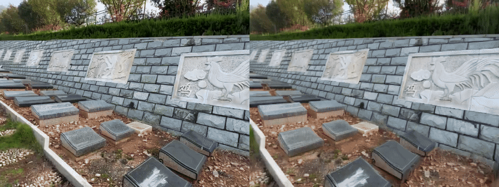

# StereoWorld — Paper Example

## Install dependencies

```bash
pip install -r requirements-paper.txt
```

## Download the checkpoint

Download [train_withRay_rowframe](https://huggingface.co/Yang-Tian/StereoWorldModelPub/tree/main/trained_models/train_withRay_rowframe):

```bash
hf download Yang-Tian/StereoWorldModelPub \
  --revision 1e6e671de5890ed9de09fe35fe6dc0b9bab06772 \
  --include 'trained_models/train_withRay_rowframe/pipeline/*' \
  --local-dir weights/paper
```

## Run the example

The example inputs are included in `examples/test_data/sample_0001`.

```bash
python examples/inference_wild.py \
  --input_dir examples/test_data/sample_0001 \
  --ckpt_dir weights/paper/trained_models/train_withRay_rowframe/pipeline \
  --output_dir output_rowframe \
  --use_prope --use_rowattn --num_views 2 --expand_raymap
```

The output is `output_rowframe/sample_0001.mp4`: a 1280×480 side-by-side stereo
video with 49 frames at 16 fps.

## Example result

The bundled example produces a 49-frame, 1280×480 side-by-side stereo video at 16 fps.



## Key Transformer code

The example enables `--use_prope --use_rowattn --expand_raymap`.
The [Transformer initialization](Diff-Factory/src/diffactory/models/transformers/wan_prope_transformer.py#L669)
installs the row-attention processor on self-attention (`attn1`) and expands
patch-embedding input channels for the raymap. Learned parameters are then
loaded from the checkpoint.

<details>
<summary><b>Camera injection: PRoPE extension</b></summary>

In [wan_prope_row.py](Diff-Factory/src/diffactory/models/attention_processor/wan_prope_row.py#L159),
additional learned projections extend Q/K by one quarter of their original dimension
(128 → 160 per head for this checkpoint). V keeps its original dimension:

```python
query_prope, key_prope = self._get_prope_qk_projections(hidden_states)
query_prope = self.norm_q_prope(query_prope)
key_prope = self.norm_k_prope(key_prope)

query_prope = query_prope.unflatten(2, (attn.heads, -1))  # (B, Seq, num_heads, head_dim)
key_prope = key_prope.unflatten(2, (attn.heads, -1))  # (B, Seq, num_heads, head_dim)

query = torch.cat((query, query_prope), dim=-1)
key = torch.cat((key, key_prope), dim=-1)
```

The camera transform combines normalized intrinsics `K` and world-to-camera
extrinsics `E`: `P = lift(K) @ E`. For this stereo example, the arguments named
`left_extrinsics` / `left_intrinsics` already contain both views, interleaved
as left/right at each latent timestep.

```python
P = torch.einsum("...ij,...jk->...ik", _lift_K(Ks_norm), viewmats)
P_T = P.transpose(-1, -2)
P_inv = torch.einsum(
    "...ij,...jk->...ik",
    _invert_SE3(viewmats),
    _lift_K(_invert_K(Ks_norm)),
)
```

The original Q/K channels receive RoPE; the added channels receive `P.T` for Q
and `P^{-1}` for K. The following transforms are applied by
[`_prepare_apply_fns`](Diff-Factory/src/diffactory/models/attention_processor/wan_prope_row.py#L277)
using `_apply_block_diagonal` before attention. Here `head_dim` is 160 and
`inner_dim` is 128. V and the attention output use identity transforms.

```python
transforms_q = [
    (partial(_rope_apply_coeffs, coeffs=rope_coeffs, inverse=True), inner_dim),
    (partial(_apply_tiled_projmat, matrix=P_T), head_dim-inner_dim),
]
transforms_kv = [
    (partial(_rope_apply_coeffs, coeffs=rope_coeffs, inverse=True), inner_dim),
    (partial(_apply_tiled_projmat, matrix=P_inv), head_dim-inner_dim),
]
```

The example also uses six-channel raymap conditioning. In the
[pipeline](Diff-Factory/src/diffactory/pipelines/video_synthesis/pipeline_video_i2v_prope.py#L346),
the raymap is concatenated with the latent before patch embedding (48 → 54
input channels):

```python
if raymap is not None:
    latent_model_input = torch.cat([latent_model_input, raymap], dim=1)
```

</details>

<details>
<summary><b>Row attention and within-view attention</b></summary>

After PRoPE, [the processor](Diff-Factory/src/diffactory/models/attention_processor/wan_prope_row.py#L198)
reshapes Q/K/V into `[batch, time × view, height, width, heads, head_dim]`.
Here `f` denotes latent timesteps, `v=2` the stereo views, and `h,w` the spatial
patch grid. Two branches share the same Q/K/V:

- **Row branch:** each spatial row attends across all latent timesteps, both
  views and all columns, without mixing different rows.
- **View branch:** each view attends across all its timesteps and spatial patches.

```python
query_row = rearrange(query_raw, "b (f v) h w nh hd -> (b h) (f v w) nh hd", v=2)
key_row = rearrange(key_raw, "b (f v) h w nh hd -> (b h) (f v w) nh hd", v=2)
value_row = rearrange(value_raw, "b (f v) h w nh hd -> (b h) (f v w) nh hd", v=2)

query_view = rearrange(query_raw, "b (f v) h w nh hd -> (b v) (f h w) nh hd", v=2)
key_view = rearrange(key_raw, "b (f v) h w nh hd -> (b v) (f h w) nh hd", v=2)
value_view = rearrange(value_raw, "b (f v) h w nh hd -> (b v) (f h w) nh hd", v=2)
```

The row branch computes non-causal attention and restores the original token
order. The view branch uses the same attention operator on `query_view`,
`key_view`, and `value_view`, also with `is_causal=False`.

```python
hidden_states_row = dispatch_attention_fn(
    query_row,
    key_row,
    value_row,
    attn_mask=None,
    dropout_p=0.0,
    is_causal=False,
    backend=self._attention_backend,
)  # (B, Seq, num_heads, head_dim)
hidden_states_row = rearrange(hidden_states_row, "(b h) (f v w) nh hd -> b (f v h w) nh hd", v=2, f=num_f//2, h=h, w=w)
```

After restoring both branches and applying the identity output transforms,
the row branch uses `self.to_out_row`, while the view branch uses
`attn.to_out[0]` and `attn.to_out[1]`. Their outputs are summed:

```python
return hidden_states_row + hidden_states_view
```

These are excerpts of the active inference path; see
[the complete processor](Diff-Factory/src/diffactory/models/attention_processor/wan_prope_row.py#L116)
for normalization, reshaping and output projection details.

</details>
